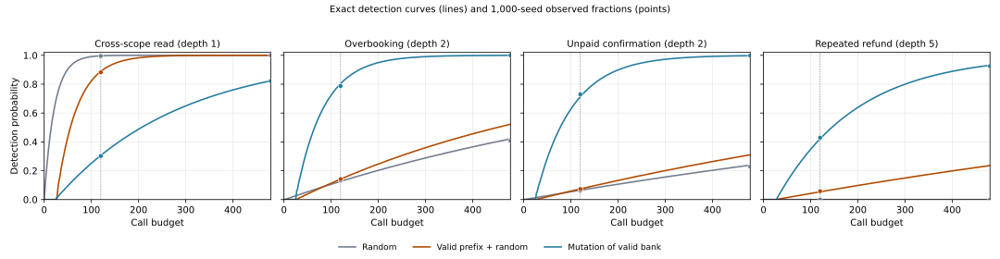

# Exact Reach Probabilities Explain and Predict Generator Tradeoffs in Stateful Authorization Testing

Ignacio Peyrano

**Working draft, 4 November 2026.** This is an empirical study with a reproducible
artifact. Every system measured here was written within this project. The study
includes a prospective test on systematically generated defects, but no independently
authored service has been measured yet.

## Abstract

Two kinds of test generators are used against stateful APIs: random generators and
generators that mutate valid workflows. Neither wins in general. Workflow mutation
finds defects that need several prior steps, and random programs find shallow scope
violations faster. We show that this tradeoff can be computed before any campaign runs.

For an authored appointment/payment service, we record the exact transition table of
the real HTTP/SQL backend over its 175-action campaign domain. From that table, an
exact dynamic program gives each generator's probability of detecting a defect within a
call budget.

The table is checked three ways:
- the unchanged campaign code reproduces all 2,740 recorded campaigns field for field;
- 8,750 transitions reached by real action paths match the table;
- a corrupted table fails 19 of 20 replays.

Exploratory analysis with 1,000 seeds per condition gives the following effects:
- Valid workflow banks raise detection of capacity, payment and refund defects from
  0–13% to 43–79% at 120 calls. Cross-scope reading moves the other way: 99.5% for
  random programs versus 30.2% for workflow mutation.
- Corpus-guided scheduling lowers detection by 12–33 percentage points relative to
  uniform workflow mutation on history-dependent defects. At 480 calls the deficit
  shrinks to 2–7 points on overbooking and confirmation but stays near 33 points on
  repeated refunds.
- An enriched feedback key helps only on overbooking: +20.7 ± 3.6 points.

In a prospective test, 14 mutants were generated by removing each guard disjunct of
the service. Predictions were derived only from the specification model, frozen with a
hash, and then compared with 1,260 real campaigns. They reproduce all 26 generator
orderings separated by at least 0.1 in probability. Exhaustive analysis shows that
three mutants have no violating program within the bounded domain; they yield
0 detections in 270 campaigns.

On the recorded table, the corrected service has no oracle violation in any program of
up to eight actions over the domain, under the assumption that behavior depends only on
the observable snapshot.

On OWASP crAPI, a service authored by others, specification-derived predictions frozen
before execution reproduce all nine generator orderings against 450 live campaigns, with
no cell deviating at p < 0.05, and the generator fingerprint differs from the authored
service as the model predicts. The authored defects and crAPI's public, documented
defects are not an unseen-defect holdout.

## 1. Introduction

Authorization in business APIs depends on more than the operation name. It depends on
who calls, on which resource, and after which history. A refund can be legitimate
once and a violation the second time. A confirmation is legitimate only after payment.
A read is legitimate only within the caller's scope.

Test generators for stateful APIs differ in how they reach such histories:
- random programs sample operations and arguments independently;
- workflow-seeded generators mutate known valid tasks;
- feedback-guided generators keep a corpus of programs indexed by abstract
  observations [9–13, 19].

Our earlier evaluations of these generators, over several fixtures and phases, gave a
consistent but unexplained pattern. Workflow mutation won on repeated refunds, unpaid
confirmation and overbooking. Random programs won on cross-scope reads. Richer
feedback helped some defects and hurt others. A list of per-property wins and losses
does not tell a practitioner what to run next, and with 10–30 seeds per condition many
of the differences were not statistically resolvable.

This paper replaces that list with a computation. For a finite campaign domain, the
probability that a generator detects a defect within a budget is determined by two
things: the service's transition structure and the generator's program distribution.
Both can be computed exactly. The minimal witness depth, the number of calls in the
shortest violating history, is a useful proxy for the comparison between random
programs and workflow mutation. The quantity that decides the comparison, however, is
the generator's *reach probability* for the violating histories.

Contributions:
1. **An exact reach analysis for stateful authorization testing.** We record transition
   tables from the real HTTP/SQL backend. Episode and budget distributions are computed
   exactly for random, prefix-extension and mutation generators. The analysis is
   validated by exact replay of 2,740 recorded campaigns, by path-based fidelity checks,
   and by an exhaustive check of the mutation enumeration.
2. **Effect sizes at resolvable precision.** Running the unchanged campaign code on the
   tables with 1,000 seeds per condition settles contrasts that 30-seed experiments
   could not. Among them, corpus guidance underperforms uniform workflow mutation on
   history-dependent defects.
3. **A prospective test across the specification/implementation boundary.**
   Predictions derived only from the specification model order the generators correctly
   on 14 systematically generated mutants, and they identify three mutants as
   undetectable within the bounded domain.
4. **A public artifact** with tables, frozen predictions, raw campaigns and replay
   commands.

We do not claim a new fuzzing algorithm, security verification of any production
system, or generalization to independently authored services.

**Evidence tiers.** Each result is labeled with one of three tiers:
- *pipeline validation*: the tables and model reproduce what was recorded;
- *exploratory*: analysis of designs and defects that informed this work;
- *prospective*: predictions frozen before execution on new defects.

## 2. Related work

**Stateful REST testing.**
- RESTler infers producer-consumer dependencies and uses execution feedback [9]. Its
  security checkers test namespace, hierarchy and use-after-free style rules [11].
- EvoMaster generates REST tests with evolutionary search [24].
- Sahin, Zhang and Arcuri [19] extend EvoMaster, building on [27], and are the closest
  work to our setting.
  - They add seven authentication and access-control oracles. Some are multi-call:
    for example, one user creates a resource and another probes it with other verbs.
  - These oracles run in a post-processing phase over the tests the search produced.
  - They evaluate one generator on 52 APIs, including crAPI, with 10 repetitions.
    They do not compare generators and do not model how likely a generator is to
    reach a violation.
  - Their oracles do not cover violations of business workflows that depend on
    history, such as repeated refunds, confirmation before payment or capacity.
    Those violations are our focus.
- RESTTESTGEN [12], mass-assignment testing [13], specification-based access-control
  detection [18] and Schemathesis [25] add nominal/error scenarios, vulnerability-specific
  oracles and schema-derived property checks.

Our generators and oracles have these antecedents. Our contribution is to explain and
predict *which* generator detects a given history-dependent defect.

**Probabilistic analyses of testing.**
- Arcuri, Iqbal and Briand give closed-form results, framed as a coupon-collector
  problem, for the time random testing needs to reach targets and for how predictable
  its reruns are [21]. Our random-generation reach probability is the same quantity
  made exact for one concrete stateful service rather than a closed form over targets.
- Böhme and Paul model testing as sampling from abstract error-based input partitions.
  They derive bounds on the cost per test beyond which random testing is more
  efficient than systematic partition testing on average [22].
- Probabilistic Concurrency Testing defines bug depth and gives detection bounds in
  terms of depth [20]. Our use of minimal witness depth follows that tradition.
- Sequence covering arrays target t-way event orders [26].

Those analyses work with abstract partitions, targets and parameters. Ours computes
exact per-generator detection distributions over a transition table recorded from a
concrete stateful implementation. It also contrasts
random generation with workflow-seeded mutation and corpus guidance under a shared
budget.

**Evaluation practice.** We follow guidance on repeated randomized trials and on
separating detected inputs from distinct defects [17]. From [23] we adopt the
Vargha-Delaney A12 effect size and its advice to report raw p-values; our paired
binary detection counts additionally use an exact McNemar test with Holm-adjusted
p-values (McNemar suits paired success/failure outcomes, which differ from the
continuous performance measures [23] centers on).

**Enabledness abstractions.** Enabledness-preserving abstractions [3, 4, 14] support
contract validation and coverage. Our earlier counterexample [1, 2] shows that one
particular global enabledness projection merges states that need different
authorization decisions. It does not refute those complete methods, and it now appears
only as background (Appendix A).

## 3. Systems, oracles and threat model

**TurnoSalon** is the primary system. It is a FastAPI/SQLite service with two salon
branches, two customers and two staff members. Its business rules:
- reservations occupy one unit of slot capacity;
- payments debit server-priced synthetic credit;
- confirmation requires payment;
- cancellation releases capacity;
- a staff refund credits the customer exactly once.

Identities are resolved from signed sessions. Writes commit in independent SQLite
transactions.

A separate specification oracle derives the expected status code, business state and
output for every call, then checks invariants over capacity, payment, refunds and
ledger balance. The oracle imports no implementation code.

The campaign domain is finite:
- 7 operations, 5 principals (including an anonymous one) and 5 resource identifiers,
  giving 175 actions;
- programs of at most 8 actions;
- 120 calls per campaign, with 480 as a sensitivity condition.

The assumed attacker chooses operations and identifiers with fixture credentials,
including foreign identifiers and repeated calls. The following are out of scope:
resource creation, concurrency within campaigns, identity management and server
compromise. Concurrent contracts are tested separately (Appendix A).

**Reviewed defects.** Four deliberate mutants each omit one guard: booking read scope,
slot capacity, payment before confirmation, and the already-refunded check. They were
reviewed and used across phases v0.5–v0.8. They informed this work and are therefore
exploratory evidence.

**Systematic mutants (prospective).** We parse `SalonService.read` and
`SalonService.transition` and remove each top-level disjunct of every
`if ...: raise` guard. This yields 18 sites with no hand selection. Four coincide with
the reviewed defects. The other 14 form the prospective set. Mutants are compiled in
memory and injected at adapter construction, and the measured source is never edited.

**Secondary fixtures.**
- A synthetic document-sharing service with eleven authored defects [v0.2].
- An existing FastAPI/PostgreSQL backend by the same author, with a public source
  subset and mitigation [v0.3–v0.4].
- A scoped RESTler setup pilot [v0.7].

They are summarized in Appendix A and documented in the cited result files.

## 4. Generators and campaigns

All generators share one campaign loop. Before each program, the service is reset to
the fixture. Every executed call is charged against the budget. An episode stops at its
first oracle violation. The campaign stops at the first matching violation, or when
the budget is exhausted.

The generators are:
- **random**: each program has a uniform length from 1 to 8, and each action is
  uniform over the 175-action domain;
- **valid replay**: one of eight legitimate task programs, unchanged;
- **valid prefix + random** (`seed_extend`): a legitimate task followed by a uniform
  random suffix;
- **mutation of valid bank** (`sequence_uniform`): a uniform source task and a uniform
  donor task, followed by one of six generic operators (field change, insert,
  duplicate, delete, swap, splice);
- **mutation of random bank**: the same mutator applied to a random bank with the same
  program lengths;
- **corpus-guided mutation** (`sequence_enabled`, `sequence_enriched`): with
  probability 0.8 the source comes from a 64-entry FIFO corpus, and otherwise from the
  valid bank. The corpus is keyed by coarse or enriched abstract transitions and
  scheduled toward rarely selected keys;
- **balanced portfolio**: random and valid-bank mutation, alternated by the calls each
  has consumed.

Every generator except random first executes its bank as a charged bootstrap (24 calls
for the valid bank). The corpus engines therefore differ from uniform mutation in
source selection, eviction and scheduling, not only in their feedback key.

## 5. Exact reach analysis

### 5.1 Recorded transition tables

For each service variant we run a breadth-first exploration. From each state, every
one of the 175 actions is executed through the real HTTP application and SQL database.
For each action we record the response, the next business snapshot and the oracle
verdict.

States are written into a disposable database before each action. Only states reached
through violation-free transitions are expanded, because episodes stop at the first
violation. Levels 0–7 are expanded, which covers every program of up to eight actions.

For the corrected service this reaches 723 expandable states and 126,525 recorded
transitions. The exploration takes about 70 seconds per variant on 14 processes, and
parallel and sequential exploration produce identical tables.

### 5.2 Episode and budget distributions

Given a table and a target property, the following episode distributions are computed
exactly with rational arithmetic, as P(detect at call c) and P(stop without detection
after c calls):
- **Random episodes**: forward dynamic programming over states, for each program length.
- **Mutation episodes**: the exact output distribution of the mutation operator,
  enumerated over every source/donor pair. A unit test drives the real mutator through
  every random-choice path and checks that the enumerated distribution is identical.
- **Prefix extension**: the deterministic prefix followed by a random suffix.

A budget dynamic program combines i.i.d. episodes with the deterministic charged
bootstrap. It gives the distribution of the first-failure call index, from which we
obtain P(detect within B) and the expected capped effort. This is exact for every
generator except the corpus and portfolio engines, whose episodes are not i.i.d.

### 5.3 Validation (pipeline tier)

- **Exact replay.** We ran the unchanged v0.5, v0.6 and v0.8 campaign code on the
  tables. All 2,740 recorded campaigns, across eight generators, five variants and two
  budgets, matched their archives in all 19 recorded fields. These fields include
  complete traces, responses, minimized witnesses and corpus statistics. As a negative
  control, a table with one corrupted status code fails 19 of 20 replays.
- **Path fidelity.** For 10 sampled states per variant, we reset the service and
  executed the real action path leading to the state, with no restoration step. We then
  compared all 175 transitions against the table: 8,750 of 8,750 matched.
- **Consistency of predictions.** Across 48 recorded cells (study × generator × defect
  × budget), observed detections are consistent with the exact probabilities: the
  minimum two-sided binomial p is 0.07, and 31 of the cells are informative
  (0.02 < p < 0.98). This is expected: an exact model of a verified replica should
  agree with the recordings. These cells confirm the pipeline. They are not
  independent predictive evidence.

### 5.4 Shortest witnesses and reach

For each variant, breadth-first search over clean transitions gives the shortest
violating history and the number of distinct shortest witnesses. This depth does not
depend on any campaign. For the four reviewed defects it equals the length of every
deletion-minimized witness recorded in v0.5–v0.8:

| Defect | Shortest witness | Depth | Distinct shortest witnesses |
|---|---|---:|---:|
| Cross-scope read | `read_booking(alice, b)` | 1 | 8 |
| Overbooking | `reserve(alice, a)`, `reserve(alice, a2)` | 2 | 16 |
| Unpaid confirmation | `reserve(alice, a)`, `confirm(staff_a, a)` | 2 | 8 |
| Repeated refund | reserve, pay, cancel, refund, refund | 5 | 16 |
| Corrected service | none within 8 actions | — | 0 |

Depth explains why random generation fails on deep defects. A uniform random program
contains a specific five-action history with probability on the order of 175⁻⁵.
Depth does not, by itself, rank generators that share structure with the witness. The
relevant quantity is each generator's per-episode reach probability.

## 6. Experimental design

| Tier | Data | Purpose |
|---|---|---|
| Pipeline validation | 2,740 recorded campaigns (v0.5, v0.6, v0.8); 8,750 path checks | Tables and model reproduce recordings |
| Exploratory | Unchanged campaign code on tables, 1,000 fresh seeds per cell (seeds 1,000,000–1,000,999) | Effect sizes for all generators |
| Exploratory | Planned v0.6/v0.8 contrasts, 30 seeds, exact McNemar, Vargha–Delaney A12, Holm | Record of originally planned tests |
| Exploratory | Document benchmark, Monte Carlo over 10,000 episodes per defect and generator | Second fixture for the reach explanation |
| Prospective | 14 systematic mutants, specification-derived predictions frozen by hash, 1,260 real HTTP/SQL campaigns (seeds 900–929) | Generator order and calibration on new defects |

The surrogate runs use the original campaign implementations. The table adapter falls
back to the real backend for any state outside the table, and no fallback occurred
(0 misses).

## 7. Results

### 7.1 Initial knowledge and perturbation (exploratory)

Detection within 120 calls, 1,000 seeds per cell:

| Generator | Cross-scope read | Overbooking | Unpaid confirmation | Repeated refund |
|---|---:|---:|---:|---:|
| Random | 99.5% | 13.1% | 6.2% | 0.0% |
| Random after charged warmup | 98.8% | 11.7% | 4.7% | 0.0% |
| Valid replay | 0.0% | 0.0% | 0.0% | 0.0% |
| Valid prefix + random | 88.2% | 14.2% | 7.3% | 5.8% |
| Mutation of random bank | 75.2% | 3.2% | 1.5% | 0.0% |
| Mutation of valid bank | 30.2% | 78.7% | 73.0% | 42.9% |
| Corpus-guided, coarse key | 29.1% | 45.8% | 49.3% | 22.0% |
| Corpus-guided, enriched key | 28.1% | 66.5% | 47.3% | 23.5% |

With the mutator held fixed, a valid bank in place of a length-matched random bank
raises detection of the three history-dependent defects by 43–76 points. It lowers
cross-scope reading by 45 points.

Reach explains both directions:
- valid tasks place the payment, cancellation and refund prefixes one mutation away
  from the witness;
- valid tasks never pair a principal with a foreign booking, so a scope witness needs
  a field mutation that the random generator gets for free on every call.

Appending random suffixes to valid prefixes recovers most of the scope detection but
little of the history detection. Replay without perturbation detects nothing.

The planned 30-seed contrasts point in the same directions. After Holm adjustment
within each study's family (24 in v0.6, 16 in v0.8), all valid-versus-random-bank
contrasts remain significant: exact McNemar, Holm p ≤ 0.025. For these four contrasts,
A12 on capped calls ranges from 0.15 to 0.84 (`results/history-depth/paired-tests.json`).

### 7.2 Corpus guidance and feedback keys (exploratory)

Paired differences from uniform valid-bank mutation, in percentage points with 95%
intervals over the same 1,000 seeds:

| Budget | Engine | Read | Overbooking | Unpaid confirmation | Refund |
|---:|---|---:|---:|---:|---:|
| 120 | Coarse corpus | −1.1 ± 3.8 | −32.9 ± 3.9 | −23.7 ± 4.1 | −20.9 ± 3.9 |
| 120 | Enriched corpus | −2.1 ± 3.8 | −12.2 ± 3.8 | −25.7 ± 4.0 | −19.4 ± 3.9 |
| 480 | Coarse corpus | −5.3 ± 3.4 | −4.7 ± 1.3 | −5.2 ± 1.4 | −33.6 ± 3.4 |
| 480 | Enriched corpus | −7.2 ± 3.5 | −1.8 ± 0.8 | −6.5 ± 1.6 | −32.7 ± 3.5 |

In this configuration, corpus guidance never improves on uniform mutation of the valid
bank. On repeated refunds, the deficit grows with the budget. The contrast changes the
source-selection probability, FIFO eviction and rare-key scheduling together, so it
does not isolate the value of feedback in general.

Holding everything else fixed, the enriched key beats the coarse key only on
overbooking (+20.7 ± 3.6 points at 120 calls). On the other three defects, the 95%
intervals include zero (−2.0 ± 3.5, −1.0 ± 2.3 and +1.5 ± 2.4 points).

With 30 seeds, the overbooking contrast had raw p = 0.0063 and Holm-adjusted
p = 0.063. That failure was a matter of power, not evidence of no effect.

**Bank sensitivity.** The valid-bank advantage is not a property of "valid tasks" in
the abstract; it is a property of whether the bank contains a task whose prefix reaches
the witness. Recomputing the exact 120-call order with one task template removed
(`results/history-depth/bank-sensitivity.json`) makes this precise:

| Defect | Full bank | Mutation after removing the enabling template |
|---|---|---|
| Cross-scope read | random wins (stable under every removal) | — |
| Overbooking | mutation 0.80 | drop the rebook task → 0.03; prefix extension wins |
| Unpaid confirmation | mutation 0.71 | drop the confirm task → 0.01; prefix extension wins |
| Repeated refund | mutation 0.42 | drop the refund task → 0.00 |

The depth-1 scope read is bank-independent. For each history defect, removing the single
template that supplies the witness prefix collapses mutation's detection and flips the
winner. The reach model predicts this: mutation only wins when a bank task sits one
operator from the witness. This both exposes the dependence on a hand-chosen bank and
shows the model explains it rather than assuming it.

### 7.3 Budget and portfolio (exploratory)

At 120 calls, the balanced portfolio lies between its components on every defect:

| Defect | Portfolio | Random | Valid-bank mutation |
|---|---:|---:|---:|
| Cross-scope read | 93.7% | 99.5% | 30.2% |
| Overbooking | 48.6% | 13.1% | 78.7% |
| Unpaid confirmation | 39.9% | 6.2% | 73.0% |
| Repeated refund | 16.7% | 0.0% | 42.9% |

At 480 calls it reaches 94–100% on the first three defects and 72.2% on refund, against
92.5% for mutation alone.

The exact model gives the whole detection curve, not only two budgets (Figure 1). The
observed 1,000-seed fractions fall on the predicted curves, and for these defects the
generator ranking does not change with the budget: random dominates the depth-1 scope
read at every budget, and valid-bank mutation dominates the history-dependent defects at
every budget. A practitioner choosing a generator does not need to guess the budget at
which the ranking flips, because here it does not flip after the first few calls.



These values also explain an apparent inconsistency between phases. Valid-bank
mutation detected cross-scope reads in 8/30 campaigns in v0.6 and in 14/30 in v0.8,
under identical settings. The exact probability is 0.30, so the v0.8 result was a
favorable draw.

### 7.4 Second fixture: the document benchmark (exploratory)

The document service has a larger action domain, including recipients and approval
tokens. Its legacy random generator differs from the business generator. We estimated
per-episode detection probabilities with the unchanged components, over 10,000
episodes per defect and generator.

Minimal witness depth separates the extremes:
- Sharing overwrite (depth 3) and approval replay (depth 5) are found by valid-bank
  mutation in 10/10 runs. Random finds them in at most 1/10, with a per-episode reach
  of at most 0.0001 against roughly 0.026 for mutation.
- Unauthorized update (depth 1) has reach 0.348 for random against 0.003 for mutation.
  Observed: 10/10 against 6/10.

Depth fails for wrong-recipient acceptance. It has depth 2, yet random detected it in
8/10 runs and valid-bank mutation in 4/10. The per-episode reach ordering agrees with
the observed direction (0.0083 against 0.0017).

The recorded minimal witnesses are an initiated share followed by acceptance from a
principal other than the pending recipient. In some, the owner accepts their own
share to Bob. In others, the share names Mallory and Bob accepts it. From the
valid bank, either form needs one specific field change in one of the two sharing tasks:
the accepting actor or the initiation target.

The budget-level predicted gap is small (7.1 against 6.3 expected detections out of 10),
and n = 10 cannot confirm the direction. This is post hoc evidence that depth is only a
proxy. It does not prove that reach is superior.

### 7.5 Prospective test on systematic mutants

The 14 prospective predictions were derived only from the specification model. To
build each one, the corresponding disjunct was removed from the oracle's
expected-behavior function, restricted to the operations that the implementation guard
covers.

Before freezing, the specification model was checked on the corrected service and on
the four reviewed defects. In all five cases its state graph and violation sets were
identical to the recorded implementation tables.

The predictions (sha256 `2138cab5…`) were committed before any campaign on the
mutants ran. The protocol is in `docs/prospective-protocol.md`.

The first execution exposed a harness defect. The compiled mutant had its own copy of
the exception class, which turned every rejection into an HTTP 500. That execution is
preserved and documented. The fix changed neither the predictions nor the analysis
plan, and the injection is now checked against the four known tables before any run.

Results of the second execution (Figure 2):
- **Generator order.** All 26 pairs whose frozen probabilities differ by at least 0.1
  were ordered correctly by the observed detection counts.
  - A depth-only rule (depth 1 → random beats workflow generators; depth ≥ 2 → workflow
    generators beat random) also gets the 15 random-versus-workflow pairs it can order
    (mutation or prefix extension).
  - The remaining 11 pairs compare prefix extension with valid-bank mutation. Depth
    cannot order them; the exact model orders all 11 correctly.
  - In the one prospective case where depth and reach disagree (`transition:66:0`), the
    predicted gap is below 0.1, and random won 29/30 against 27/30.
- **Bounded-equivalent mutants.** Three mutants have no violating program within eight
  actions. For each, the implementation table is identical to the specification table,
  and neither contains a violation (`results/prospective/diagnosis.json`). The reasons
  differ:
  - `64:0`, removing "payer is not a customer": staff never own a booking, so the other
    disjunct of the same guard still rejects them;
  - `64:1`, removing "payer does not own the booking": the scope check already limits
    customers to their own bookings;
  - `69:0`, removing the balance check: under this fixture, no customer balance falls
    below 2,000 credits within the domain, so the guard can never fire. That is a
    property of the fixture, not of the code.

  These mutants produced 0 detections in 270 campaigns.
- **Calibration.** The frozen metric is the number of cells with p < 0.05 over all
  cells: 4 of 42 (`51:0` and `54:0` prefix extension, `66:0` prefix extension, `66:1`
  mutation). About 2 are expected by chance at this threshold, so 4 is within sampling
  variation. Restricting to the 20 cells with a non-degenerate prediction
  (0.02 < p < 0.98), a declared secondary view, leaves 3.
  - The four deviating sites were diagnosed, not assumed to be noise. Their
    implementation and specification graphs are identical
    (`results/prospective/diagnosis.json`), and all recorded campaigns on them replay
    exactly on the implementation tables.
  - We re-ran each deviating cell with the unchanged campaign code and fresh seeds
    (`results/prospective/model-check.json`). The 3,000-seed estimates match the frozen
    probabilities: `51:0` 0.996 vs 0.996, `54:0` 0.894 vs 0.889, `66:0` prefix
    extension 0.567 vs 0.586, `66:0` random 0.930 vs 0.933. For `66:1` mutation the
    pooled 12,000-seed estimate is 0.496 vs the predicted 0.489.
  - We found no model error. Every deviation is a low-probability draw at n = 30, not a
    miscalibrated prediction.


### 7.6 Bounded exhaustive check of the corrected service

For the corrected service, the table covers every program of up to eight actions over
the 175-action domain. No transition from any reachable clean state produces an oracle
violation, so no such program violates the oracle.

This replaces the earlier statement that finite control campaigns observed no
violation. Its scope is: this fixture, no resource creation, at most eight actions, and
only properties observable by the oracle. It is exact with respect to the recorded
table, and the table equals the backend under the assumption that behavior depends only
on the observable snapshot (Section 9), checked on a 50-state path-fidelity sample.

### 7.7 Earlier phases

The earlier phases remain consistent with the reach account, and Appendix A
summarizes them. In the AoristoTech HTTP/PostgreSQL case:
- valid-task mutation detected repeated cancellation (depth 2) in 10/10 runs, against
  0/10 for random;
- random detected foreign-store reads (depth 1) in 9/10, against 3/10.

The RESTler setup pilot could not reach the legitimate refund workflow within its
budget. This is consistent with, though not computed as, the near-zero reach of
generators that cannot assemble the payment and cancellation prefix.

### 7.8 Independent service: OWASP crAPI (prospective)

The strongest test of the method is a service this project did not author. OWASP crAPI
is an intentionally vulnerable application; we study its shop (orders, returns, refunds)
at the pinned revision `700f03d1`, with every container pinned by digest. We write a
specification of its intended behavior from the documented challenges and the OpenAPI
descriptions (disclosing that the vulnerable view code was read first), and define a
finite domain of two customers and seven shop operations.

Because crAPI contains several real defects at once, we target five rule families and
stop each episode only at its target property. The exact reach model is computed per
target from the specification, and the predictions were frozen by hash
(`results/crapi/predictions.json`) before any live campaign ran. We then ran 450 live
HTTP/SQL campaigns (3 generators x 5 targets x 30 seeds, budget 60) against the
unmodified crAPI shop, with the business oracle judging every transition. The only
environment change is pointing crAPI's unused external payment gateway at a dead port so
order reads do not stall; it never affects the oracle (`docs/crapi-protocol.md`).

The frozen predictions reproduce all nine generator orderings whose probabilities differ
by at least 0.1, and no cell deviates from its predicted detection at p < 0.05
(`results/crapi/comparison.json`). Two rule families have no reachable violation within
the domain and yield 0 of 30 for every generator, as predicted.

The generator fingerprint differs from the authored salon service, and the model
predicted the difference:
- crAPI's defects are shallow (reading another user's order is depth 1; tampering with
  an order's status or quantity is depth 2), so random and valid-prefix extension beat
  valid-bank mutation on all three detected families — the reverse of the salon
  history-dependent defects.
- Order-privacy (depth 1) is won by random (28/30), order tampering (depth 2) and
  refund-without-return (depth 2) by valid-prefix extension (24/30 and 17/30), while
  valid-bank mutation is weakest on each (9, 8 and 3 of 30), because crAPI's valid tasks
  do not sit one mutation from these witnesses.

This is prediction across the specification/implementation boundary on a service of
another author. crAPI remains an intentionally vulnerable training application with
public challenges, so this is implementation independence, not discovery of unknown
defects.

## 8. Discussion

**A precomputation before fuzzing.** When the action domain is finite and the
specification is executable, a generator's detection probability for a hypothesized
defect can be computed before running it. In our setting this takes about one minute
per mutant on the specification model.

The practical use is allocation. Reach probabilities tell where random programs suffice
(shallow scope checks), where workflow seeds are necessary (payment and refund
histories), and where neither will succeed within a budget. Systematic guard-removal
mutants of the specification can stand in for unknown defects.

**Seeds are knowledge, and their placement matters.** The same valid tasks help when
they are mutated internally, and they barely help as a prefix to random suffixes.
Mutation keeps the dependency structure of the task while changing the critical step.
A random suffix rarely produces the specific repeated or out-of-order call.

**Corpus guidance needs evidence.** In this domain, a coverage-style corpus diverts
effort away from the complete valid tasks whose single mutations reach the violations.
Because the gap persists at four times the budget, large on refunds and smaller
elsewhere, it is not only a warmup cost. Other
domains may favor corpus guidance. The broader point is that a 30-seed experiment
cannot resolve such differences, and an exact replica can.

**Why exact rather than bounded.** Analytic bounds such as PCT's [20] guarantee a
minimum detection probability as a function of depth. Our domain is small enough to
compute exact values, and exactness is what makes generators with the same depth
comparable. The cost is scale. The approach needs a finite action domain, resettable
state and tractable reachable state counts (723 here). Abstraction or sampling would be
required beyond that.

## 9. Threats to validity

**Construct.** Detection is measured against our specification oracle. The
specification and the implementation share an author. Their identical state graphs on
the known variants show agreement, not independent correctness.

The prospective predictions come from the specification model, and the specification
mutants are mapped to implementation mutants by a hand-written table
(`integrations/salon_prospective/spec.py`) written with both in view. Graph identity was
verified for 12 of the variants (5 pre-freeze checks and the 7 diagnosed mutants), not
for the other 7 prospective mutants. Where the graphs coincide, the prospective test
measures the fidelity of that mapping as much as a prediction crossing the
specification/implementation boundary. An independently authored service, where no such
mapping is possible, is the real test; crAPI is a step toward it.

Reach probabilities are defined for the campaign domain. Arguments outside it, such as
new resources and free-form payloads, are not modeled.

**Internal.** The tables assume that behavior depends only on the observable business
snapshot, because a state is reached by restoring that snapshot with SQL. Path-based
fidelity checks support this on 50 sampled states, not exhaustively. The assumption
holds here because booking identifiers are fixed, no resources are created, and
execution is single-threaded. It would break under concurrency, state kept outside the
database (sessions or tokens), timestamps, or identifiers whose value changes behavior.
In crAPI the risk is higher: sequences are not reset between the service's own calls and
authentication carries state, so the symbolic order binding is sound only while behavior
does not depend on the concrete order id, which must be checked and stated there.

The four reviewed defects shaped the method. Only the 14 systematic mutants are
prospective. The valid-task bank is eight hand-written programs; because the reserve,
pay, cancel, refund template is exactly the repeated-refund witness prefix, mutation is
one insertion from that witness. A bank-sensitivity analysis (Section 7.2) recomputes
the generator order with templates removed or added.

**External.** The authored systems are small, and the mutant operator family
(guard-disjunct removal) is narrow, so real defects may be distributed differently. The
independent evaluation on OWASP crAPI (Section 7.8) removes the shared-authorship
objection for the implementation, but crAPI is still an intentionally vulnerable
training application whose defects are public, not an unseen-defect holdout, and its
specification was written by us. A stronger RESTler configuration and a comparison with
EvoMaster's access-policy oracles [19] remain open.

**Conclusion.** Surrogate effect sizes use 1,000 seeds per cell within one service.
They describe search-seed variation, not variation across systems. The 30-seed planned
tests are reported with Holm adjustment. They are the original record, not the basis
for the effect sizes above.

## 10. Conclusion

Generator tradeoffs in stateful authorization testing need not be found by trial. For a
finite domain, a generator's probability of exposing a history-dependent violation is
computable from the transition structure and the generator's program distribution.

Minimal witness depth is a useful proxy for that probability. The probability itself
explains the cases where depth fails. Computed from a specification alone, it predicted
the generator order for new systematic defects before execution.

The same replica turns underpowered comparisons into precise ones. With it, corpus
guidance in this service trails plain mutation of valid workflows. The next test of the
approach is an independently authored service.

## Artifact availability

Source, tables, raw campaigns, frozen predictions and figures are at
https://github.com/PeyranoDev/semantic-gateway-lab. To reproduce:
```
python -m pip install -r backends/salon/requirements.lock
TMPDIR=/dev/shm python scripts/analyze_history_depth.py build|replay|analyze|stats|surrogate 1000|fidelity 10
TMPDIR=/dev/shm python scripts/prospective_salon.py predict|run|compare|diagnose
python scripts/analyze_document_reach.py 10000
python scripts/plot_reach.py
```
`TMPDIR=/dev/shm` only places the disposable SQLite files in memory.
The claims and their limits are mapped in `claims-and-evidence.md`.

## Appendix A. Earlier phases

| Phase | Fixture | Campaigns | Role here |
|---|---|---:|---|
| v0.1–v0.2 | Synthetic document service, 11 authored defects | 1,080 (v0.2) | Second fixture for reach (Section 7.4); enabledness counterexample |
| v0.3–v0.4 | AoristoTech FastAPI/PostgreSQL subset and mitigation | 120 + controls | Depth pattern in an existing backend; public reproduction of 150 witnesses |
| v0.5 | TurnoSalon, 4 reviewed defects | 640 | Recorded campaigns replayed exactly |
| v0.6 | TurnoSalon component study | 1,200 | Recorded campaigns replayed exactly; planned contrasts |
| v0.7 | Official RESTler setup pilot | 60 | External-tool observation; no refund reachability |
| v0.8 | Fixed portfolio, budgets 120/480 | 900 | Recorded campaigns replayed exactly |

Details: `results.md`, `sequence-results.md`, `aoristo-results.md`,
`mitigation-results.md`, `salon-results.md`, `component-results.md`,
`restler-pilot-results.md`, `portfolio-results.md`.

**Enabledness counterexample.** Let alpha_E map a state to the set of tool names enabled
by existential lifecycle conditions. Suppose two states have equal alpha_E but
different authorization decisions for the same fully specified invocation. Then no
function of (alpha_E(s), a) reproduces the decision. Executable witnesses exist in the
document service, where one sharing prefix designates Bob and the other Mallory, and in
the salon service, for confirmation of the same booking. Our feedback keys are used for
search only, while the runtime and the oracle inspect full state.

## References

See `references.md` ([1]–[27]). The full texts of [19], [21], [22], [23] and [27] have
been read; for [20], [24], [25] and [26], only bibliographic metadata and abstracts have
been verified.
