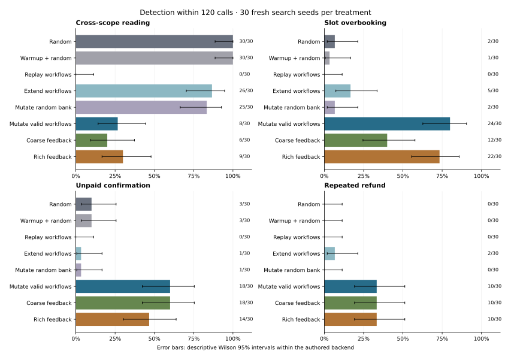
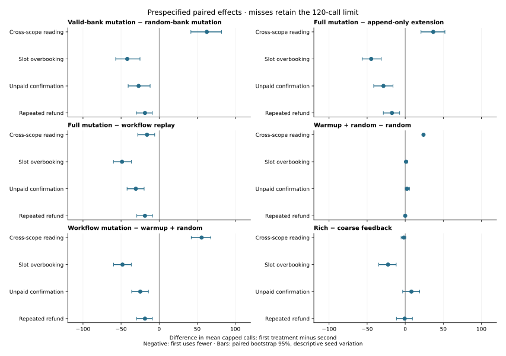

# Workflow-Seeded Authorization Testing: Separating Initial Knowledge, Sequence Mutation, and State Feedback

Ignacio Peyrano

**Working draft, 14 October 2026.** This is a controlled empirical study and a
reproducible research artifact. The observed effects concern reviewed fixtures
and authored systems. External-tool benchmarking, complete review of closely
related EPA testing work and independent policy review remain outstanding.

## Abstract

Authorization and business integrity depend on principals, resources and
execution history. A global set of callable operation names can therefore merge
states that require different decisions for the same invocation. This observation
does not determine which state representation is most efficient for testing.
We study that distinction with separately specified oracles that check decisions,
responses and actual business effects across a document benchmark, an existing
FastAPI/PostgreSQL backend and a newly authored appointment/payment service.
Historical comparisons show that mutation of legitimate tasks reaches some
history-dependent faults missed by random programs, while random programs more
often expose simple scope violations. A further 1,200-campaign evaluation uses
30 fresh search seeds and eight treatments to distinguish initial workflow
knowledge, whole-program perturbation, append-only extension, charged warmup
and matched coarse/enriched feedback. Valid-bank mutation detects overbooking in 24/30, unpaid confirmation in
18/30 and repeated refund in 10/30, versus 2/30, 1/30 and 0/30 for mutation of
length-matched random banks. The direction reverses for cross-scope reading:
8/30 versus 25/30. An append-only baseline also outperforms full mutation for
reading but underperforms on those history-dependent targets. Richer feedback
improves overbooking while showing mixed effects on other properties.
Every detected original and deletion-minimized witness is reexecuted against
the measured HTTP/SQL service. The artifact retains censored misses, separate
cost categories, all prespecified paired effects and fixed controls. The
contribution is bounded comparative evidence and an executable authorization
testing artifact; it is not a novel stateful-fuzzing algorithm, independent
production generalization, a security proof or an evaluation of LLM/MCP behavior.

## 1. Introduction

A successful connection to an API or tool does not establish authority for a
particular execution. Reading another client's reservation, refunding a payment
twice or accepting a sharing request as the wrong recipient can violate the
contract even when the operation name is callable. Conversely, an HTTP error
does not guarantee that the database was unchanged. Effective testing must
check parameterized calls and history-dependent effects.

Our earlier preprint [1] proposed a Semantic Gateway and its companion proof of
concept [2] illustrated a sharing defect through a graph containing a prepared
faulty edge. Here the unit of evaluation is an executed request and its observed
business state. Closely related research already provides stateful request
generation, sequence mutation and security-property checkers [9-13]. We build
on that setting and make the contribution an explicitly bounded comparative
study of authorization-oriented workflow testing.

The research questions are:

1. **RQ1 — Information:** can our global operation-enabledness projection merge
   states requiring different authorization decisions for the same call?
2. **RQ2 — Initial knowledge and perturbation:** under a fixed call budget, how
   do valid versus random initial programs, complete-program mutation,
   append-only extension and warmup change discovery of reviewed fault families?
3. **RQ3 — Feedback:** when seeds, mutation and scheduling are matched, how does
   a richer observational corpus key change detection and capped effort?

The intended contributions are executable information-loss witnesses, a public
artifact connecting specification oracles to HTTP/SQL business effects, and a
controlled evaluation that exposes both benefits and regressions. We do not
claim invention of seeded sequence mutation or security-property testing.
Originality relative to the complete closest literature remains subject to review.

## 2. Related work and positioning

Enabledness-based abstractions support contract and behavior validation [3-4].
Godoy et al. also investigate enabledness-based coverage for object-protocol
testing [14]. Our hand-written global projection is a deliberately simplified
observational key; its counterexample does not refute the guarantees of those
complete methods. The reviewed primary source for [14] is the authors' published
summary, and a full journal-text review remains necessary.

RESTler [9] generates request sequences using producer-consumer dependencies
and execution feedback. AFLNet [10] mutates protocol message sequences and uses
observed response information for guidance. These establish relevant prior work
for stateful generation and mutation; neither is an executed treatment here.

The closest security antecedent is RESTler's active-checker work [11], which
tests user namespaces, resource hierarchy, access after deletion and effects
following failed creation. Our scope and denied-effect checks overlap those
concerns. Our comparative focus is workflow knowledge, perturbation and
authorization-oriented corpus feedback with a common specification oracle;
that focus does not establish superiority over RESTler.

RESTTESTGEN [12] addresses nominal and error API scenarios, and security-specific
sequence/oracle testing also appears in mass-assignment research [13]. Our valid
workflow bank, domain oracle and HTTP checks must be positioned against these
antecedents. The targeted review and inspected-source limits are documented in
literature-review.md; it is not a systematic literature review.

AgentGuard, MCPSHIELD and HCP [5-7] provide agent-security context. Their arXiv
metadata/abstracts were verified, but their systems and guarantees are not
replicated. MCP authorization [8] is transport-related background. This paper
measures API/tool execution testing without language models or MCP transport.

## 3. Systems, contracts and threat model

### 3.1 Synthetic document service

The system under test is a deterministic document service reached through structured
tool invocations. An untrusted proposer selects a tool and arguments. The harness
supplies an authenticated principal from a finite fixture; it does not permit role
claims in generated tool arguments to create authority. Server state determines
ownership, departments, ACL membership and workflow phase.

The four principals, candidate resources and ten tools are specified in the artifact.
Sharing requires an owner-manager to initiate a request for a same-department
recipient. Only that pending recipient may accept. An owner-manager may revoke
sharing. Deletion requires a draft resource, a deletion request and an unexpired,
single-use approval scoped to actor, resource and operation. Read/export operations
require same-department ownership or granted ACL membership. Denied calls may not
change business state and must leave an audit record.

A trusted fixture issues HMAC-authenticated test approvals. This simulates an
external approval authority, not a production human approval mechanism. The test
clock is fixed; approval expiry boundaries and reuse are tested against that clock.
Approvals are not generation-bound. Concurrent actions, server compromise, changing
policies, arbitrary binary tools and real model prompt injection are out of scope.

Eight original implementation mutants remove or weaken checks. Three additional
synthetic variants disclose object identifiers in list responses, permit non-owner
updates or permit cross-department sharing. The generator does not receive defect
labels. All eleven defects were authored within this project and the same backend;
the new variants are not independently sourced held-out vulnerabilities.

The replay witness recreates the same resource identifier after deletion. The
fixture tests consumed-grant history without generation/version binding; no claim
is made that production systems with non-reused identifiers exhibit this defect.

### 3.2 Existing and authored business APIs

AoristoTech is an existing implementation by the same author. Its original
FastAPI routes, authenticated dependency chain, repositories and PostgreSQL
business effects are evaluated for store scope, cancellation and invitation
workflows. The public subset has documented bootstrap/registry adaptations;
its observations are compared against historical full-source witnesses. Original
serial savepoint campaigns and independent-transaction mitigation checks are
different experiments and remain labeled separately.

TurnoSalon is a new research service for two salon branches. Database-resolved
customers can act on their own bookings; staff can act within their branch.
Reservations occupy capacity, payments debit server-priced synthetic credit,
confirmation requires payment, cancellation releases capacity once, and a staff
refund must credit the customer once. SQL writes commit in file-backed SQLite
transactions. Four isolated deliberate mutants omit a relevant guard; the
generator does not receive those labels. Creation, identity forgery, rollback
and selected concurrent operations are checked outside the finite campaign.

All three domains share project authorship. The assumed attacker can select
operations and arguments using fixture credentials, including foreign resource
identifiers and repeated calls. Server compromise, production identity management,
unbounded resource creation and independently reviewed business policies are
outside the measured campaign scope.

## 4. Abstraction and action distinguishability

Let S be the service's concrete state space and a be a fully specified invocation
including principal, resource, tool and parameters. Let Allow(s,a) be the reference
authorization decision. Define alpha_E(s) as the set of tool names enabled by
existential lifecycle conditions over fixture objects. This projection does not
encode authorization for each parameterized invocation.

**Proposition.** If states s1 and s2 satisfy alpha_E(s1) = alpha_E(s2), but
Allow(s1,a) differs from Allow(s2,a) for an identical invocation a, there is no
decision function f(alpha_E(s),a) that exactly reproduces Allow on both states.

**Proof.** The inputs to f are identical for both states, so its output must be
identical. The required decisions differ, yielding a contradiction.

This elementary argument concerns information loss in the projection. It is not a
novel formal-verification theorem or proof of gateway security. The executable
counterexample supplies two sharing prefixes: one designates Bob, the other
Mallory. Both enable the same tools, but Bob's identical acceptance call has
different authorization outcomes. A bounded explorer enumerates states reached
with a five-action subalphabet to depth three and records the witness.

The enriched projection alpha_R augments alpha_E with object phase, deletion-request
status, principal-resource relations and consumed approval nonces. It separates
the recipient witness. No general property-preservation or minimality result is
claimed for this projection. A finer projection may also fragment the exploration
corpus and consume more replay budget.

The proposition concerns exact authorization reconstruction from the projection.
Our projections are used for feedback selection only. The runtime and oracle
continue to inspect full concrete state. Thus a projection can lose distinctions
while still being useful for testing; a coarser search key does not itself weaken
the service's authorization boundary. This distinction motivates measuring
discovery rather than inferring it directly from representational fidelity.

## 5. Testing methodology

The harness executes requests and captures before/after business snapshots and
visible responses. Separate domain oracles derive decisions, effects and expected
outputs; the document oracle additionally checks denied-call audit completeness.
They import neither implementation authorization helpers nor feedback logic. Shared fixture assumptions
remain a possible source of correlated mistakes and require independent review.

### 5.1 Historical document engines

The three v0.1 engines remain byte-for-byte unchanged. They use uniform arguments,
with two variants preferring lifecycle-enabled tool names and reusing state-reaching
prefixes indexed by coarse or enriched projections. They are rerun at the same
v0.2 budgets and seeds as the new engines. For new synthetic variants only, the
single-threaded harness substitutes the service constructor without editing their
generation, selection or oracle code. A regression test verifies unchanged
behavior on an original variant.

The new engine initializes six legitimate workflow programs. Sharing programs
include initiation, acceptance, read and revocation. Deletion programs include
two authorized lifecycle transactions using distinct fresh fixture approvals.
A final program covers list/read/update/export. None contains an unauthorized
terminal operation or imports known failing regression traces.

Generic operators change a field, insert a call, duplicate a contiguous segment,
delete a step, swap calls or splice a fragment from another legitimate program.
Insertions retain the anchor principal/resource; field mutations preferentially
sample values already observed in the program. Approvals are test-fixture outputs,
not guessed cryptographic signatures.

A no-corpus engine selects these seeds uniformly. Two matched corpus engines use
the identical mutator, seeds, capacity of 64 and inverse-selection-count scheduler.
They differ only in coarse versus enriched feedback keys. Each key identifies an
observed abstract transition and retains one shortest complete tested program.
FIFO eviction bounds memory. Multiple keys may select the same program, so
partitioning changes effective sampling weights as well as information retained.

Two ablations remove recipient or consumed-approval predicates. Another retains
full enrichment but selects stored programs uniformly. An owner-only ablation is
implemented and tested, but not included in the measured matrix.

All bootstrap, repeated, denied and mutation-source-prefix calls consume budget.
Legacy selected-prefix replay and new unchanged-source-prefix counts differ and
are not pooled as one overhead metric. Campaigns stop at their first oracle
violation or budget exhaustion. Deletion-based shrinking occurs afterward and
has a separate call count. Every detected original and minimized trace is replayed
in a separate analysis process; minimized traces are also checked on the fixed service.

### 5.2 Business-domain transfer and component controls

The business integrations use a uniform finite domain of operations, principals
and resources, and six generic program mutations. The four v0.3/v0.5 engines
are random programs, uniform selection of valid seed programs for mutation,
and two matched corpus engines. Business mutations use uniform field domains;
this differs from the document mutator's anchor/observed-value preferences.

The v0.6 evaluation freezes the salon service and adds four policies: charged
valid warmup followed by independent random programs; unchanged replay of valid
tasks; valid tasks followed by random suffixes; and mutation of a random initial
bank. The random bank uses an independent deterministic RNG and the same eight
program lengths as the valid bank. It is not filtered by execution or oracle
outcome. All engines except random execute their initial bank, and those calls
consume budget. The fixture resets between episodes; warmup does not retain
business state for later random programs.

The original four modes are preserved exactly at equal seed/target/settings,
as checked by regression comparisons of their semantic result fields. Program
selection has no oracle or mutant-label dependency. Only safe observed prefixes
are retained by the corpus, whose capacity and rare-selection scheduler are
unchanged. seed_extend retains a complete valid prefix and appends uniform
random actions; it is an internal baseline, not an implementation of RESTler.

Six pairs are fixed before execution: random/valid bank under matched mutation,
extension/full mutation, unchanged replay/mutation sanity control, charged warmup
versus random, workflow reuse plus mutation after matched warmup, and matched
coarse/enriched feedback. The fifth contrast changes both reuse and generation,
so it is not interpreted as a mutation-only effect. Full details, exclusions
and analysis definitions are in docs/salon-ablation-protocol.md.

## 6. Experimental setup

The v0.1 artifact contains a 270-run pilot (seeds 0-9, budget 1500, depth 12)
and an 810-run larger-budget matrix (seeds 100-129, budget 10000, depth 20).
Their 3,233,104 executed calls are preserved as historical evidence. The second
matrix was configured after inspecting the pilot and is not independently preregistered.

The v0.2 protocol was committed before execution. It is nevertheless an exploratory
follow-up designed after inspecting v0.1, not an independent confirmatory study.
Ten new seeds (200-209), nine engines and twelve variants yield 1080 runs, each
with budget 3000 and depth 20. There are three legacy engines, six sequence engines,
eight original defects, three new synthetic defects and a fixed control.

Source/config/seed-program hashes identify each measured implementation. Historical
source hashes remain valid. The v0.2 phase had 65 automated tests; the accumulated
artifact now has 122 tests when the optional HTTP dependencies are installed.
GitHub Actions executes the matrix and the separate witness-validation analysis.
The matrix consumes 1,147,407 actual service calls before its stop conditions.

Primary measures are detection fraction and first-failure call index. Undetected
runs remain right-censored, contributing the full budget to mean capped effort.
Wilson intervals summarize seed variation within this benchmark, not real-world
breach probability. Same-seed descriptions record detection discordance and
right-minus-left capped-effort differences; no significance claim is made.

Auxiliary corpus diagnostics use fixed-control runs only, so all methods complete
the full budget and avoid early-stopping coverage differences. Per-call timings
describe instrumented in-process execution, not network, model or deployment latency.

### 6.1 Business phases and prospective component evaluation

The original Aoristo matrix has 120 campaigns at budget 120. Its public original
subset replays 150 archived original/minimized witnesses; each corrected assembly
has 120 bounded control campaigns. These related assemblies are not independent
implementations. The v0.5 salon matrix has 640 campaigns over 20 search seeds,
four engines and isolated mutants plus fixed targets.

v0.6 uses 30 new seeds (600-629), eight engines, budget 120, depth eight and corpus
64. Four mutants each have one target: 960 campaigns. The fixed service has 240
ANY controls, one per engine/seed, observing all oracle properties without
duplicating identical streams for multiple target labels. Total: 1,200 campaigns.
The protocol was committed before execution, after v0.5 informed its design;
this is a prospective follow-up on reviewed defects, not external preregistration.

Each of the 24 prespecified mutant-property contrasts reports paired detection
discordance and right-minus-left mean capped calls. Percentile intervals use
5,000 deterministic bootstrap resamples of the 30 seed pairs. They describe
within-fixture seed variation and are not confidence statements across systems,
nor multiplicity-adjusted hypothesis tests. All contrasts are reported, including
unfavorable and zero effects. Same seed labels do not imply identical random
draws at every call because engines consume RNG differently.

## 7. Results

Detailed tables, paired descriptions and full-budget diagnostics are in
sequence-results.md; raw evidence and manifests are in results/sequence-v02.
The historical matrices remain documented in results.md.

### 7.1 Synthetic document benchmark

#### 7.1.1 Sequence-dependent discovery

For approval replay, each legacy engine discovers zero failures in ten runs.
All six sequence-mutation engines discover the defect in 10/10 at the same
3000-call budget. The no-corpus seed mutator has mean capped effort 218.4 calls,
coarse guidance 595.4 and full enriched guidance 198.2.

This comparison changes both initial workflow knowledge and mutation operators
relative to v0.1. It supports the combined workflow-seeded system in this fixture,
not an isolated mutation-only or abstraction-only benefit.

Sharing overwrite is found by legacy coarse guidance in 1/10 runs and by the
three principal seed-mutation variants in 10/10. Capped effort is 168.8 calls for
no-corpus mutation, 228.4 for coarse guidance and 540.8 for full enrichment.

#### 7.1.2 Negative results and property dependence

Wrong-recipient discovery is 10/10 for each legacy guided engine but 6/10 for both
new guided engines, with four censored misses. The no-corpus seed mutator finds
4/10. Approval-scope and unauthorized-update results are also mixed. Therefore
the new engine is not a universal replacement, and a single overall detection
percentage would conceal relevant per-property tradeoffs.

Removing approval history raises observed replay effort from 198.2 to 300.3 calls,
but lowers overwrite effort from 540.8 to 135.3. Uniform selection with enriched
keys produces 221.1 replay calls and 322.8 overwrite calls. These descriptive
contrasts motivate property-sensitive feedback and scheduling rather than the
claim that every additional predicate improves exploration.

#### 7.1.3 Exploration cost and validation

At equal full budget, coarse sequence guidance has mean 145.6 corpus evictions and
mean stored-program length 7.0; full enrichment has 683.3 evictions and length 10.4.
Unchanged source prefixes consume 45.7% versus 47.5% of calls respectively.
These diagnostics establish higher observed turnover and longer stored programs
for enrichment in this configuration. They do not independently prove why one
method wins on a particular defect.

All 829 recorded failures have their original and minimized witnesses replayed.
Each minimized witness produces no oracle disagreement on the fixed service.
The 90 fixed-control campaigns produce zero observed violations in 270,000 calls.
These are bounded validation results, not a proof of universal safety.

### 7.2 AoristoTech HTTP/PostgreSQL case study

The optional v0.3 integration exercises the original FastAPI ASGI HTTP pipeline,
authentication/service guards and SQL repositories of the pinned AoristoTech
backend against PostgreSQL 16.15. Only the database dependency is overridden for
serial program isolation. ORM metadata supplies the schema, and source commits
release savepoints inside an outer rollback transaction. Production migrations,
independent network transactions and concurrent races are not represented.

Eleven positive/denial controls pass and seven reviewed regressions reproduce,
including foreign-store reading/cancellation, foreign-unit invitation effects
and repeated cancellation that increases stock from 7 to 10 to 13. Invitation
creation can store a row before returning a response-validation error mapped to
404; a failed HTTP response therefore does not establish absence of an effect.

The matrix comprises 120 runs, four engines, three target properties and ten
seeds, with 120 calls per campaign. Seed mutation without corpus detects repeated
cancellation in 10/10 runs versus 0/10 for random programs. Conversely, random
programs detect foreign-store reading in 9/10 versus 3/10 for that seed mutator,
and invitation scope in 10/10 versus 6/10. The matched coarse/enriched engines
both detect cancellation replay in 9/10 and foreign-store reading in 4/10;
invitation scope is 6/10 versus 5/10. These small mixed contrasts establish no
general enrichment advantage.

All 75 detected campaigns have original and minimized witnesses reexecuted.
The matrix consumes 8,268 campaign calls; all recorded stages total 8,831 HTTP
executions. Full results, cost categories, censoring and provenance are in
aoristo-results.md and results/aoristo-v03.

The source is another implementation by the same author. Policies and reviewed
defects are not independent or held out. Reproducing the original complete
assembly requires private source access; the public subset below reproduces
the archived witness observations without that access. This adds bounded evidence from another domain,
not an independently validated enterprise deployment.

### 7.3 Public real-source extraction and mitigation

An owner-authorized source subset now makes the selected case executable without
private-repository access. It includes 81 Python files, 62 copied verbatim and 19
documented adaptations for bootstrap, configuration, module exports and the ORM
registry. The original subset reproduces all 150 historical original/minimized
witness traces at the observed HTTP/business-state boundary. This is finite
observational agreement, not an equivalence theorem for the complete application.

The same 11-module patch is tested on the public subset and the full application.
It adds store-scoped queries, trusted resident/staff unit/building scope, correct
invitation response mapping and transactional pending-sale cancellation. Each
corrected assembly passes 21 checks and 120 campaign conditions with no oracle
disagreement in 14,400 calls. Synchronized concurrent HTTP cancellation returns
200/400 and restores stock once; an injected post-stock failure rolls back both
stock and sale status using the actual SQL repositories.

These results demonstrate mitigation of reviewed discrepancies in the selected
domain. They do not establish independent generalization, production-migration
compatibility or broader application security. The public source, patch, evidence
and reproduction commands are documented in mitigation-results.md and
case_studies/aoristo/README.md.

### 7.4 Newly authored appointment/payment backend

TurnoSalon adds a different business contract and persistence mechanism:
two salon branches, customers and staff, capacity-limited slots, reservations,
synthetic-credit payments, confirmation, cancellation and refunds. The service
uses FastAPI, database-resolved identities from signed sessions and file-backed
SQLite WAL transactions with independent connections and committed writes.
It was created for the experiment rather than taken from a production system.

The v0.3 mutator is copied byte for byte and the campaign implementation changes
only its module description. Domain declarations, eight legitimate seed programs,
observations, feedback projections and the separate specification oracle are new.
The call budget (120), maximum depth (8), corpus capacity (64), operators and
80% guided-selection rule are retained. The protocol and configuration were
committed before the first full matrix, with no later tuning of search parameters.

Four isolated deliberate mutants omit reading scope, slot-capacity enforcement,
payment before staff confirmation, or the already-refunded check. Each mutant
has one target; the fixed control runs all four targets. Twenty seeds per
engine/target produce 320 mutant campaigns and 320 controls. As before, only
the enabled/enriched pair isolates feedback; comparisons to random or uniform
mutation include other treatment differences.

Uniform workflow mutation detects overbooking in 16/20, unpaid confirmation in
13/20 and repeated refund in 9/20, versus 2/20, 0/20 and 0/20 for random programs.
Random detects cross-scope reads in 19/20 versus 6/20 for uniform mutation.
The matched enriched/coarse pair detects overbooking in 10/20 versus 7/20, unpaid
confirmation in 11/20 versus 13/20, and ties on read scope and refund at 8/20 and
6/20. These mixed descriptive differences do not establish general superiority.

All 134 detected campaigns have original and deletion-minimized witnesses
reexecuted, giving 268 exact response/state revalidations. The fixed control
executes 38,400 search calls without any observed oracle discrepancy. Total
HTTP executions across authentication, controls, search, shrinking and witness
verification are 71,674; contract tests and the TCP smoke are accounted separately.
Fixed targets reuse seed/mode streams and are not independent replications.

Nineteen additional tests cover HTTP/SQL business rules, identity forgery,
resource creation, refund rollback and synchronized concurrent requests using
independent SQL connections. Both last-slot contention and double-refund checks
return 200/409 with one effect. A separate smoke completes the business lifecycle
over loopback TCP; the campaign itself uses in-process ASGI HTTP. Another test
exhibits equal globally enabled-tool sets with different correct decisions for
confirming the same booking.

This transfers execution and search to a new authored contract. It does not
provide independent production generalization or held-out discovery. Credits
are simulated; the finite campaign uses four provisioned bookings and tests
creation separately. SQLite BEGIN IMMEDIATE serializes writers and is not a
substitute for PostgreSQL race evaluation. Detailed results and reproduction
commands are in salon-results.md and case_studies/salon/README.md.

### 7.5 Prospective separation of workflow knowledge, perturbation and feedback

The 1,200-campaign component study records 292 detections and 584 exact original/
minimal witness revalidations. The 240 fixed ANY controls complete 28,800 search
calls without any oracle discrepancy. Across all stages, the main matrix uses
129,799 HTTP executions, of which 125,061 are search calls. The first execution
was repeated after repairing only tuple/list normalization in the offline summary
verifier; archived semantic outcomes from all 1,200 pairs are compared excluding
elapsed time. Neither engine policy nor configuration was tuned after that repair.

Under the same mutation controller, a valid rather than random length-matched
initial bank detects overbooking in 24/30 versus 2/30, unpaid confirmation in
18/30 versus 1/30, and repeated refund in 10/30 versus 0/30. Cross-scope reading
reverses that result, 8/30 versus 25/30. Twenty of those random-bank read detections
occur during bootstrap; they are not attributed solely to mutation.

Complete-program mutation also outperforms valid-prefix random extension on
overbooking (24/30 versus 5/30), unpaid confirmation (18/30 versus 1/30) and refund
(10/30 versus 2/30). Extension detects more cross-scope reads, 26/30 versus 8/30.
Its change in program distribution is retained as a treatment difference; it is
an internal generator, not an external-tool reproduction.

Unchanged replay of valid tasks detects no faults and is treated as a sanity
control. Charged warmup followed by independent random programs produces no
improvement in observed detection rates; on reads it preserves 30/30 while
adding exactly 24 calls before the same random traffic. Warmup's state is reset,
so this result is specific to discarding state and not reusing the bank.

The matched enriched/coarse pair detects overbooking in 22/30 versus 12/30,
unpaid confirmation in 14/30 versus 18/30, reading in 9/30 versus 6/30, and refund
in 10/30 for both. Mean right-minus-left capped effort for enrichment is -22.57
calls for overbooking (descriptive paired-bootstrap interval -34.74 to -11.87)
and +8.13 for unpaid confirmation (-3.33 to 19.00). These intervals describe
seed variation in the reviewed fixture; they are not cross-system or multiplicity-
adjusted significance claims.

The complete 24 prespecified effects, censoring, bootstrap origins, cost categories
and source repair are documented in component-results.md. Figures 1 and 2 retain
every treatment and contrast rather than selecting only positive outcomes.

## 8. Threats to validity

**Construct validity:** lifecycle availability is a deliberately coarse projection;
results do not establish limitations of every sound enabledness-preserving method.
The abstract keys contain hand-selected predicates and no general sufficiency proof.

**Internal validity:** implementation and separately specified oracle can share mistaken
business assumptions. Corpus fragmentation, replay overhead and uniform argument
generation can limit guided testing. Campaigns stop at first failure, affecting
observed coverage. The pilot informed later designs, both v0.1 evaluations informed v0.2, and
v0.5 informed the prespecified v0.6 component controls.
Workflow seeds encode domain knowledge; they are a substantive treatment
difference. v0.6 controls separate bank quality, perturbation and feedback within
the same authored service, rather than establishing effects across systems.
Corpus capacity and hand-selected predicates constrain the observed tradeoffs.

**External validity:** the synthetic in-memory benchmark and AoristoTech case
study both use small finite fixtures and are authored within this project.
They do not represent enterprise deployments. AoristoTech's ORM-schema and
savepoint isolation further limit transfer to live production behavior.
No language model, transport MCP implementation, OPA process or human
operator was evaluated. Discovery campaigns are serial; selected mitigation and
business contract tests separately exercise synchronized concurrent requests. Real attacks may be distributed differently from mutants.

**Conclusion validity:** seed variation is not variation across independent systems.
Conditional medians are subject to detection selection; capped effort and censoring
must accompany them. No-failure runs support only bounded observational claims.

## 9. Discussion and remaining evaluation

Representing authorization distinctions and efficiently searching for violations
are separate objectives. A projection can merge decisions and still guide useful
tests because concrete authorization and oracle checks remain in place. Conversely,
a finer corpus can retain more keys without improving discovery under a budget.
We therefore report property-level detection, capped effort and censored misses,
and avoid ranking every configuration by one aggregate percentage.

The component evaluation distinguishes several uses of task knowledge: replay,
post-task random extension, mutation of the task interior, and mutation of random
banks. These operational distinctions matter when interpreting differences from
a random-program reference. The specific comparisons and their caveats should be
retained when designing a hybrid or changing the corpus; the present study has
not tuned or evaluated such a hybrid after seeing the results.

The most material remaining evaluation is a real external-tool comparison and
an independently authored service or independent policy/oracle review. The
concrete protocol gates are documented in docs/external-baseline-protocol.md.
Existing stateful generators and security checkers are close antecedents and
cannot be replaced in such a comparison by our append-only internal baseline.
A complete review of EPA testing [14] is also outstanding.

A separate full-budget state-exploration study would be needed to compare
coverage without first-failure stopping. Generation-bound approvals, policy
changes and concurrent distributed histories remain future cases. An LLM/MCP
study must define legitimate/adversarial tasks, model and transport versions,
runtime effects and call/token costs separately; none is represented here.

## 10. Conclusion

The artifact demonstrates information loss in a particular global operation
projection and evaluates executable authorization testing with separately
specified effects. Across reviewed fixtures, task-seeded testing has benefits
and regressions that depend on the property. A prospective component evaluation
adds explicit controls for initial knowledge, perturbation and feedback, while
public HTTP/SQL cases make witnesses and selected mitigations reproducible.
The resulting contribution is comparative evidence within authored systems.
It supports further external evaluation without identifying finite fuzzing with
security verification or claiming a new general stateful-fuzzing algorithm.

## Artifact availability

The repository at https://github.com/PeyranoDev/semantic-gateway-lab includes source,
unit/regression tests, configurations, raw experiments, replayable witnesses,
summaries and this draft. Campaign manifests identify the exact measured source.
The AoristoTech integration publishes synthetic observations and source hashes;
the selected public source subset and patch are bundled separately, while the
complete private backend implementation is not. The newly authored salon backend,
frozen protocols, raw observations, component effects, scientific figures and
replay commands are public. Claims and remaining review gates are mapped in
claims-and-evidence.md.

## References

See `references.md`. The inspected-source audit is in literature-review.md. Full review of the
remaining closest sources and venue-specific formatting are required before submission.
