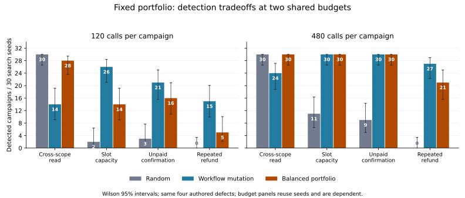

# v0.8: a fixed portfolio exposes a budget tradeoff

**Complete exploratory evaluation, 15 October 2026.** The 50/50 call-balanced
portfolio does **not** satisfy the frozen criterion for broad improvement. It
raises scope-error detection relative to workflow mutation, but sacrifices
history-sensitive detection at the primary 120-call budget. At 480 calls it
matches the better constituent on three defect families and still loses on refund.

## Design and provenance

The source/protocol were published at
`30bfd41ef70eef98e715f6925c255f05631a185a` before execution. The complete run used
commit `1528f5d96aa0484d85c461cd0bfb660b1bae92bb`, which adds only a remote execution
workflow; all measured source/config hashes are unchanged. All 139 tests passed.
The completed [GitHub Actions run](https://github.com/PeyranoDev/semantic-gateway-lab/actions/runs/38751685998)
contains the official artifact, ID 11982625921, SHA-256
`135c6f5cf08ccdbce1eb9c8d6e972ff15e052b988eaa1abaef5837f8ddcf2a8b`.

Three treatments × five assemblies × 30 seeds × two request budgets = 900 campaigns.
Seeds 800–829 are new search seeds on the same four reviewed mutants. Budgets
120 and 480 reuse streams and are dependent sensitivity conditions. All treatments
stop on the first discrepancy of the same ANY-property oracle. Requests use the
FastAPI TestClient ASGI HTTP path and real SQLite; this is not a TCP throughput
comparison. Python 3.12.15 and SQLite 3.45.1 were used in Actions.

The scheduler selects the constituent that has consumed fewer actual business
requests, breaking ties toward random generation. It sees only counts; it receives
no mutant, target property, response or oracle result. The two RNG streams match
the corresponding standalone streams. Valid workflow warmup is charged, global
budget limits include every constituent call, and sequence-boundary balancing
can overshoot an exact half split by at most depth 8.

## All detections, without selecting the favorable budget

Each cell is detected campaigns / 30; campaigns reproducing the same mutant are
not distinct vulnerabilities.

| Budget | Defect family | Random | Workflow mutation | Balanced portfolio |
|---:|---|---:|---:|---:|
| 120 | Cross-scope reading | 30/30 | 14/30 | 28/30 |
| 120 | Slot capacity | 2/30 | 26/30 | 14/30 |
| 120 | Unpaid confirmation | 3/30 | 21/30 | 16/30 |
| 120 | Repeated refund | 0/30 | 15/30 | 5/30 |
| 480 | Cross-scope reading | 30/30 | 24/30 | 30/30 |
| 480 | Slot capacity | 11/30 | 30/30 | 30/30 |
| 480 | Unpaid confirmation | 9/30 | 30/30 | 30/30 |
| 480 | Repeated refund | 0/30 | 27/30 | 21/30 |

The primary 120-call criterion required no observed detection loss against either
constituent on any defect and at least one gain. It fails. At 480 calls the portfolio
still loses six refund detections relative to mutation, despite adding six scope
detections. Equal weighting of these four defects produces the same 111/120 total
for portfolio and mutation at that budget, hiding the opposite property-level effects.
This aggregate is only descriptive and is not a reason to select the larger budget
or to claim equivalent performance across properties.



## Effort and uncertainty

Mean capped calls, counting every miss at its assigned bound:

| Budget | Defect family | Random | Workflow mutation | Portfolio |
|---:|---|---:|---:|---:|
| 120 | Cross-scope reading | 23.50 | 94.83 | 40.13 |
| 120 | Slot capacity | 112.37 | 75.83 | 98.73 |
| 120 | Unpaid confirmation | 111.80 | 77.90 | 101.33 |
| 120 | Repeated refund | 120.00 | 95.40 | 114.30 |
| 480 | Cross-scope reading | 23.50 | 198.00 | 43.53 |
| 480 | Slot capacity | 392.57 | 79.77 | 151.60 |
| 480 | Unpaid confirmation | 408.13 | 90.10 | 160.90 |
| 480 | Repeated refund | 480.00 | 185.07 | 280.90 |

These are means of min(T, budget), not uncensored expected discovery times.
All 16 planned paired effects and 5,000-resample descriptive intervals are in
results/salon-v08/effects.json. At 120 calls, portfolio-minus-mutation detection
fractions are +0.467 for scope, -0.400 for capacity, -0.167 for unpaid confirmation,
and -0.333 for refund. At 480 they are +0.200, 0, 0, and -0.200. Intervals are
unadjusted and conditional on these exact defects; no cross-system significance
or general superiority is claimed. The full table retains both portfolio-minus-
random and portfolio-minus-mutation contrasts.

## Controls, accounting and interruption recovery

- 900 complete campaigns; 446 detected campaigns across four known mutants.
- 160,806 search calls; 168,581 HTTP calls including login, controls, shrinking
  and the runner's exact validation stage.
- 180 fixed campaigns: 54,000 search calls with no observed oracle discrepancy.
- 60 setup controls passed; each recorded original/minimized witness was replayed
  exactly (892 pairs of recorded/live traces, not 892 different defects).
- A subsequent verifier repeated all 892 witnesses, adding 2,416 business calls
  and 20 fixture login calls outside the runner's 168,581 total.
- Source/config hashes, every scheduler decision, SQL witness continuity, the full
  matrix, costs and all reported statistics were verified again locally.

The first local attempt was interrupted after 810 completed campaigns. Its raw
rows and starting hashes are preserved under results/salon-v08-interrupted. Every
one of those rows matches the corresponding complete-run row after excluding only
elapsed_s. There was no search-policy, source or parameter change. The incomplete
attempt is not pooled into the primary estimates. Unsaved in-flight work prevents
an exact all-attempt resource total; the reported totals describe the complete run.

The figure script initially encountered floating-point roundoff at the zero-width
end of a Wilson error bar. Only plotting clamps negative roundoff in error lengths
to zero; raw intervals, summaries, source and observations were not changed.

## Interpretation and next test

This fixed allocation trades request opportunities: it can reach the broad random
search stream while retaining valid histories, but approximately halves the
workflow component's available mutation budget. The effect of that allocation
must be measured, not assumed beneficial from constituent complementarity. There
was no ratio sweep and this result does not justify selecting a new ratio on the
same observations and calling it confirmatory evidence.

EnFuzz [15] and EcoFuzz [16] are prior ensemble/resource-allocation research; this
portfolio is neither a reproduction of them nor a new general scheduling method.
Evaluation guidance in [17] motivates reporting both fixed budgets and all outcomes.
The next major evidence gains remain a RESTler configuration with validated
legitimate workflow reachability and independent implementation/policy evaluation.
OWASP crAPI is assessed in docs/independent-backend-candidate.md but is not yet an
executed treatment or an unseen-defect holdout.

## Reproduction

```
python -m pip install -r backends/salon/requirements.lock
python -m unittest discover -s tests -v
python -m scripts.verify_salon_portfolio results/salon-v08 --replay
python -m scripts.check_portfolio_recovery
python -m integrations.salon_portfolio.run --out results/local-v08-rerun
python -m pip install -r paper/requirements-figures.txt
python -m scripts.plot_salon_portfolio
```

The full archived run includes controls and all detection traces plus scheduling
ledgers. It does not contain every successful SQL snapshot from search; a complete
rerun is necessary to audit all negative observations independently. Fixed controls
support only the reported finite budget, not proof of security.
